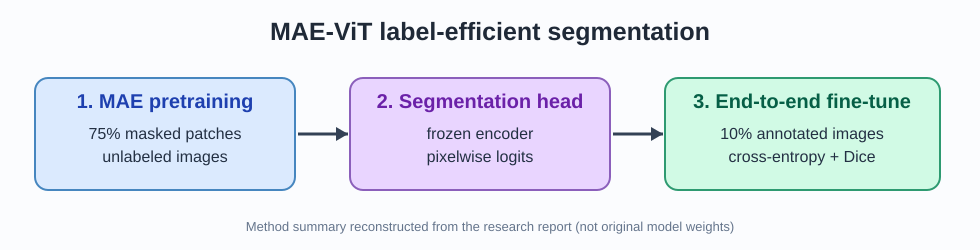

<h1 align="center">MAE-ViT for Label-Efficient Semantic Segmentation</h1>

<p align="center"><strong>Self-Supervised Learning · Computer Vision · Semantic Segmentation</strong></p>
<p align="center">Academic Research Project · Friedrich-Alexander-Universität Erlangen-Nürnberg (FAU)</p>

<p align="center">
  
  
  
  
  
</p>
<p align="center">
  
  
  
</p>
<p align="center">
  <a href="#methodology">Methodology</a> · <a href="#reported-experimental-results">Results</a> · <a href="#installation">Installation</a> · <a href="#quick-start-synthetic-data">Quick start</a> · <a href="#testing-and-reproducibility">Testing</a> · <a href="#research-limitations">Limitations</a>
</p>

---

## Project Overview

This academic research project explores whether self-supervised masked autoencoder (MAE) pretraining can support semantic segmentation with limited labeled training data. The study investigates Vision Transformer (ViT) representations, a segmentation head and end-to-end fine-tuning on ADE20K and Cityscapes, using a reported 10% labeled training-image subset.

The repository contains a compact PyTorch reference implementation, dataset loaders, training and evaluation scripts, tests, and figures and CSV tables summarizing the historical research findings.

> **Reproducibility statement:** Historical metrics are transcribed from the September 2025 academic research report and author-provided terminal screenshots. They have not been independently verified or reproduced by the newer reference implementation in this repository. The original training scripts, model checkpoints and exact split IDs were not supplied. The reference code is not the original experiment code.

## Research Highlights

| Component | Scope |
|---|---|
| Research question | Semantic segmentation with a 10% labeled training subset |
| Pretraining | Masked pixel reconstruction using 75% random patch masking |
| Backbone | Vision Transformer (ViT) |
| Datasets | ADE20K (150 classes), Cityscapes (19 classes) |
| Downstream training | Frozen-backbone head training, then end-to-end fine-tuning |
| Evaluation | Mean Intersection over Union (mIoU) |
| Implementation | Compact PyTorch reference code for inspection and small experiments |

## Methodology



### 1. Self-supervised pretraining

The reported methodology resizes RGB inputs to 224 × 224, divides them into 16 × 16 patches (196 tokens), randomly masks 75% of patches, and trains a ViT encoder and lightweight decoder to reconstruct masked pixels with mean-squared error.

### 2. Segmentation head training

A transposed-convolution upsampling head produces per-pixel semantic class logits from patch features. Initially, the encoder is frozen and the head is trained on labeled images.

### 3. End-to-end fine-tuning

The encoder is unfrozen and the full segmentation model is optimized with cross-entropy and soft Dice loss. The historical study describes a 10% labeled training subset.

| Reported experimental parameter | Value |
|---|---|
| Input resolution | 224 × 224 |
| Patch size | 16 × 16 |
| Random masking | 75% |
| Training label budget | 10% of labeled training images |
| Epoch configurations | 10 and 50 |
| Batch sizes | 4 and 8 |
| Optimizer | AdamW |
| Learning rate | 1e-4 |
| Weight decay | 0.05 |
| Reported hardware | NVIDIA T4 (16 GB) |

The newer reference implementation uses its own compact model configuration (default embedding dimension 192, depth 4, fixed sinusoidal positional encodings). These are implementation choices, not verified specifications of the original trained backbone. See [methodology documentation](docs/METHODOLOGY.md).

## Reported Experimental Results


| Dataset | 10 epochs / batch 4 | 10 epochs / batch 8 | 50 epochs / batch 4 | 50 epochs / batch 8 |
|---|---:|---:|---:|---:|
| ADE20K | 1.74% | 2.00% | 26.00% | **28.50%** |
| Cityscapes | 0.32% | 0.50% | 16.00% | **18.20%** |

All entries above are historical reported mIoU results for the 10%-label study, not results from the current reference code.

The original report cites OneFormer literature reference values of 57.70% (ADE20K) and 83.00% (Cityscapes) under a different, full-supervision training and evaluation protocol. These values are not a matched experimental baseline and cannot isolate the effect of MAE pretraining or establish relative model superiority.


### Training evidence


- ADE20K terminal screenshot (10 epochs, batch 4): pretraining loss decreased from 0.9426 to 0.0347; fine-tuning loss from 4.7932 to 3.5839. After five additional end-to-end epochs, reported average mIoU was 1.74%.
- Cityscapes terminal screenshot (10 epochs, batch 4): pretraining loss decreased from 1.0707 to 0.0253. Fine-tuning loss ranged from 2.8113 to 1.7486, with a NaN loss recorded at epoch 7; subsequent end-to-end losses decreased to 1.6567. Reported average mIoU was 0.32%.
- The report contains conflicting epoch labels (entries at epochs 25 and 50 in columns labeled 10 epochs). These are not treated as valid 10-epoch end measurements.

### Results files

| File | Evidence source |
|---|---|
| [Reported mIoU](results/reported_miou.csv) | Historical report values and external reference values |
| [Reported pretraining loss](results/reported_pretraining_loss.csv) | Historical report values |
| [Screenshot-derived training logs](results/screenshot_training_logs.csv) | Author-provided terminal screenshots, including anomalous values |

See [results provenance](docs/RESULTS_NOTES.md) for interpretation and source caveats.

## Repository Structure

```text
mae-vit-label-efficient-segmentation/
├── src/mae_vit_seg/        # Reference model, data loaders, losses and metrics
├── scripts/                # Training, evaluation and toy data utilities
├── tests/                  # Unit tests (as described in repository documentation)
├── results/                # Historical reported values and screenshot-derived logs
├── figures/                # SVG summaries of reported results and methodology
├── docs/                   # Methodology, datasets, provenance and privacy notes
├── pyproject.toml           # Python package and optional dependencies
├── requirements.txt        # Dependency list
├── .gitignore
└── README.md
```

## Installation

Requires Python 3.10+ and PyTorch. Clone the repository and create a virtual environment:

```bash
git clone https://github.com/MD-IKRAM169/mae-vit-label-efficient-segmentation.git
cd mae-vit-label-efficient-segmentation
python -m venv .venv
```

Windows PowerShell:

```powershell
.\.venv\Scripts\Activate.ps1
```

Linux/macOS:

```bash
source .venv/bin/activate
```

Install the package and testing dependencies:

```bash
python -m pip install -e ".[dev]"
python -m pip check
```

## Quick Start (Synthetic Data)

This CPU smoke test uses generated toy images, not real benchmark datasets. It checks the reference workflow, not historical benchmark reproduction. Run from the repository root. Commands are single lines for PowerShell and Bash compatibility.

```bash
python scripts/make_toy_data.py --output-dir data/toy_ade20k --image-size 64
python scripts/pretrain.py --dataset ade20k --data-root data/toy_ade20k --output-dir outputs/toy_pretrain --device cpu --epochs 1 --batch-size 2 --image-size 64 --embed-dim 48 --depth 1 --heads 3 --decoder-dim 32 --decoder-depth 1 --decoder-heads 4
python scripts/finetune.py --dataset ade20k --data-root data/toy_ade20k --output-dir outputs/toy_seg --device cpu --epochs 1 --head-epochs 1 --batch-size 2 --train-fraction 0.5 --pretrained outputs/toy_pretrain/mae_last.pt
python scripts/evaluate.py --dataset ade20k --data-root data/toy_ade20k --checkpoint outputs/toy_seg/segmenter_last.pt
python -m pytest -q
```

The toy workflow deliberately uses a 50% labeled subset and a smaller model for functionality testing, not the 10% historical study setting. The evaluation script selects CUDA if available and otherwise CPU. These commands preserve the existing documented example; a clean-environment execution has not been independently verified for this README revision.

### Generated outputs

The synthetic workflow writes the following local artifacts:

| Path | Purpose |
|---|---|
| `outputs/toy_pretrain/mae_last.pt` | Reference MAE checkpoint and model configuration |
| `outputs/toy_pretrain/pretrain_log.csv` | Masked reconstruction loss by epoch |
| `outputs/toy_seg/segmenter_last.pt` | Final segmentation checkpoint |
| `outputs/toy_seg/segmenter_best.pt` | Best checkpoint when a finite validation mIoU is obtained |
| `outputs/toy_seg/finetune_log.csv` | Training loss and validation mIoU by stage and epoch |

Use fresh output directories for repeat experiments because the CSV logger appends to existing logs. Keep generated checkpoints and datasets local; they are excluded by `.gitignore`. Load only trusted checkpoints.

## Real Dataset Experiments

Obtain authorized datasets separately and follow [dataset setup instructions](docs/DATASETS.md). Raw ADE20K and Cityscapes data, original historic model weights and original training code are not redistributed here.

Example reference experiment (replace the path with your own ADE20K directory):

```bash
python scripts/pretrain.py --dataset ade20k --data-root /path/to/ADEChallengeData2016 --output-dir outputs/ade_pretrain --epochs 50 --batch-size 8
python scripts/finetune.py --dataset ade20k --data-root /path/to/ADEChallengeData2016 --pretrained outputs/ade_pretrain/mae_last.pt --output-dir outputs/ade_seg --epochs 50 --head-epochs 2 --batch-size 8 --train-fraction 0.10
python scripts/evaluate.py --dataset ade20k --data-root /path/to/ADEChallengeData2016 --checkpoint outputs/ade_seg/segmenter_best.pt
```

### Dataset conventions

| Dataset | Training classes | Expected masks |
|---|---:|---|
| ADE20K | 150 | `annotations/training/` and `annotations/validation/`; source IDs 1–150 map to 0–149, with void ignored |
| Cityscapes | 19 | `gtFine/train/` and `gtFine/val/`; raw label IDs map to semantic train IDs |

See [dataset setup](docs/DATASETS.md) for the full directory layouts and licensing links. Masks use nearest-neighbor resizing to preserve categorical IDs.

For Cityscapes, use `--dataset cityscapes` and an appropriate Cityscapes dataset root. GPU memory requirements vary; batch size 8 may exceed available memory. The reference subset uses a fixed seed (default 42), not the original experiment's sample-ID split. The reference metric ignores target ID 255 and excludes classes with zero union. Check benchmark evaluation conventions before comparing results with external studies.

## Testing and Reproducibility

The repository documentation describes tests for the model, preprocessing and metrics. Run the test suite locally after installing the development extras:

```bash
python -m pytest -q
```

Test success establishes only the behavior covered by the tests. It does not independently establish historical benchmark accuracy or full-scale training reproducibility.

[View repository automation and workflow status](https://github.com/MD-IKRAM169/mae-vit-label-efficient-segmentation/actions). Workflow results, when available, are the source of truth for automated checks; no passing status is assumed here.

For repeatable experiments, retain the model configuration, data split identifiers, random seed, dependency versions, hardware details and training logs. The current dependency declarations specify minimum versions rather than a fully locked environment.

## Research Limitations

- Original model architecture details, training scripts, checkpoints, exact sample splits and complete class-wise results are unavailable.
- Historical metrics have not been reproduced independently using the current implementation.
- Some reported epoch labels are inconsistent; a Cityscapes training screenshot contains a NaN loss.
- OneFormer literature values use a different protocol and are not a controlled comparison.
- No repeated-seed or confidence-interval analysis is documented; the claim that labeling effort can be reduced without sacrificing quality is not supported by these comparisons.
- A supplied street-scene overlay appears to reference another segmentation architecture and is not presented as an output of this implementation.

See [results notes](docs/RESULTS_NOTES.md) for detailed caveats.

## Documentation and References

| Document | Description |
|---|---|
| [Methodology](docs/METHODOLOGY.md) | Architecture and implementation design choices |
| [Dataset setup](docs/DATASETS.md) | Dataset formats, label mapping and subset sampling |
| [Results provenance](docs/RESULTS_NOTES.md) | Historical results and methodological caveats |
| [Publishing checklist](docs/PRIVACY.md) | Data rights, image attribution and privacy |

- He et al., *Masked Autoencoders Are Scalable Vision Learners* (2022): https://arxiv.org/abs/2111.06377
- Dosovitskiy et al., *An Image Is Worth 16×16 Words* (2021): https://arxiv.org/abs/2010.11929
- Jain et al., *OneFormer* (2023): https://arxiv.org/abs/2211.06220
- ADE20K: https://groups.csail.mit.edu/vision/datasets/ADE20K/
- Cityscapes: https://www.cityscapes-dataset.com/

## Data Access and License

Respect the original dataset access requirements and third-party image and software rights. A redacted research report candidate and additional figures exist in the project preparation archive but are not yet committed; verify redactions, permissions and attribution before publishing them.

For software reuse, consult the repository’s license file if one is provided. If no explicit license is present, do not assume permission to reuse or redistribute the software. A software license does not override third-party dataset, figure or research-document rights.

## Conclusion

The project illustrates a three-stage approach to label-efficient segmentation, from masked reconstruction through supervised head training and encoder fine-tuning. The historical report motivates further research into annotation efficiency, while the reference implementation provides a transparent starting point for new experiments. The reported benchmark values remain historical evidence rather than validated performance claims for the current code.

## Author

**Md Ikram Tareq** · M.Sc. Data Science, FAU Erlangen-Nürnberg, Germany

[LinkedIn](https://www.linkedin.com/in/md-ikram-tareq/) · [Portfolio](https://md-ikram169.github.io/) · [GitHub](https://github.com/MD-IKRAM169)
