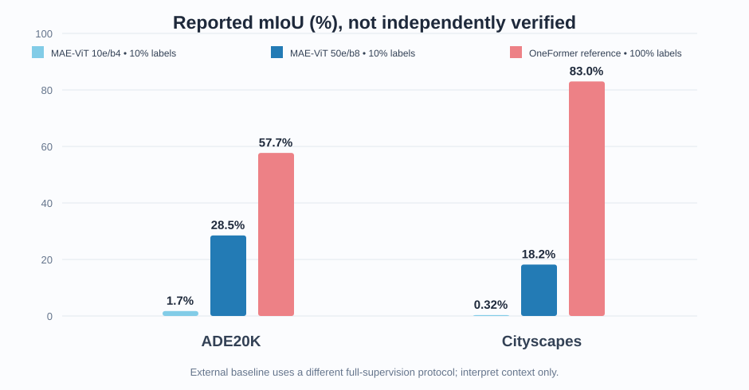
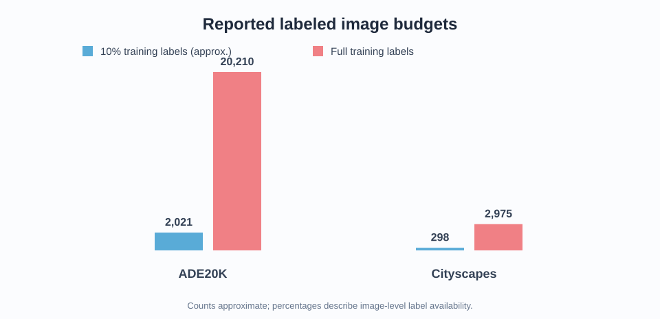
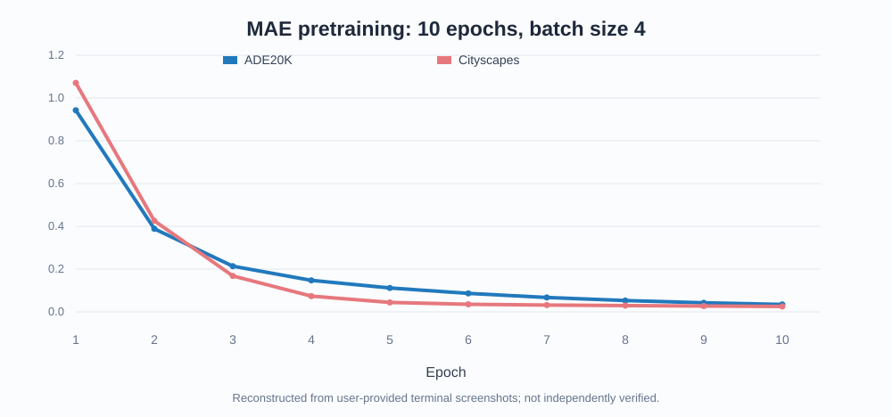

# MAE-ViT for Label-Efficient Semantic Segmentation

**Masked Autoencoder (MAE) · Vision Transformer (ViT) · Self-Supervised Learning · Semantic Segmentation**

Research project by **Md Ikram Tareq**, Friedrich-Alexander-Universität Erlangen-Nürnberg (FAU), 2026.

> **Reproducibility statement:** Benchmark results below are **reported in the supplied September 2025 research report or terminal screenshots**, not independently verified. The accompanying PyTorch code is a **new reference implementation** based on that methodology; it is **not the original experiment code** and has **not reproduced** the historic benchmark numbers. Original checkpoints and training scripts were not provided.

## Research question

Can self-supervised MAE pretraining enable semantic segmentation with only **10% of labeled training images**? This work explores 75% random patch masking, ViT representations, head-only training and end-to-end fine-tuning, comparing epochs (10 and 50) and batch sizes (4 and 8) on **ADE20K** and **Cityscapes**.

## Method

1. **Masked pretraining:** 224×224 RGB inputs → 16×16 patches (196 tokens), 75% masked; reconstruct masked pixels with a ViT encoder and lightweight decoder.
2. **Segmentation head:** attach a transposed-convolution upsampling head and initially freeze the backbone.
3. **End-to-end fine-tuning:** unfreeze the encoder and optimize cross-entropy + Dice loss using a 10% labeled training subset.

The report describes AdamW with learning rate 1e-4, weight decay 0.05 and an NVIDIA T4 (16 GB). See [methodology](docs/METHODOLOGY.md).

## Reported experimental findings

| Dataset | MAE-ViT 10 epochs, batch 4 (10% labels) | MAE-ViT 50 epochs, batch 8 (10% labels) | OneFormer reference (full labels) |
|---|---:|---:|---:|
| ADE20K | 1.74% | **28.50%** | 57.70% |
| Cityscapes | 0.32% | **18.20%** | 83.00% |

The OneFormer values are quoted as a **literature reference with a different training and evaluation protocol**, **not** an apples-to-apples controlled experiment.

Additional reported metrics: at 50 epochs/batch 4, ADE20K 26.00% and Cityscapes 16.00%; at 10 epochs/batch 8, ADE20K 2.00% and Cityscapes 0.50%. See [numeric CSVs](results/) and [results provenance](docs/RESULTS_NOTES.md).

**Caution:** The report tables contain values at epochs 25 and 50 under experiments marked as 10-epoch runs. These entries are inconsistent and are not treated as valid 10-epoch end measurements. The Cityscapes terminal screenshot also shows a NaN training loss at epoch 7; this is preserved in the screenshot-derived CSV rather than hidden.

## Repo contents

- [src/mae_vit_seg/](src/mae_vit_seg/) — compact MAE encoder/decoder, ViT segmentation head, losses, data loaders and mIoU metric.
- [scripts/](scripts/) — pretrain, fine-tune, evaluate, visualize predictions and generate toy data.
- [tests/](tests/) — unit tests for model, preprocessing and metrics.
- [results/](results/) — **reported** table values and training-loss logs transcribed from the supplied screenshots.
- [figures/](figures/) — lightweight, version-controlled SVG summaries generated from the reported numbers.
- [docs/](docs/) — methodology, dataset formats, sources, caveats and reproducibility guidance.

Raw ADE20K/Cityscapes datasets, large model weights, and original historic code are **not redistributed**. See [dataset instructions](docs/DATASETS.md).

## Quick start (synthetic data)

Requires Python 3.10+ and PyTorch. The following is a functionality smoke test, **not** a reproduction of research benchmarks.

~~~bash
git clone https://github.com/MD-IKRAM169/mae-vit-label-efficient-segmentation.git
cd mae-vit-label-efficient-segmentation
python -m venv .venv
source .venv/bin/activate  # Windows PowerShell: .venv\Scripts\Activate.ps1
python -m pip install -e '.[dev]'

python scripts/make_toy_data.py --output-dir data/toy_ade20k --image-size 64

python scripts/pretrain.py --dataset ade20k --data-root data/toy_ade20k \
  --output-dir outputs/toy_pretrain --device cpu --epochs 1 --batch-size 2 \
  --image-size 64 --embed-dim 48 --depth 1 --heads 3 \
  --decoder-dim 32 --decoder-depth 1 --decoder-heads 4

python scripts/finetune.py --dataset ade20k --data-root data/toy_ade20k \
  --output-dir outputs/toy_seg --device cpu --epochs 1 --head-epochs 1 \
  --batch-size 2 --train-fraction 0.5 --pretrained outputs/toy_pretrain/mae_last.pt

python scripts/evaluate.py --dataset ade20k --data-root data/toy_ade20k \
  --checkpoint outputs/toy_seg/segmenter_last.pt

python -m pytest -q
~~~

## Real datasets

Download the dataset separately and follow [DATASETS.md](docs/DATASETS.md). For example:

~~~bash
python scripts/pretrain.py --dataset ade20k --data-root /path/to/ADEChallengeData2016 \
  --output-dir outputs/ade_pretrain --epochs 50 --batch-size 8
python scripts/finetune.py --dataset ade20k --data-root /path/to/ADEChallengeData2016 \
  --pretrained outputs/ade_pretrain/mae_last.pt --output-dir outputs/ade_seg \
  --epochs 50 --head-epochs 2 --batch-size 8 --train-fraction 0.10
python scripts/evaluate.py --dataset ade20k --data-root /path/to/ADEChallengeData2016 \
  --checkpoint outputs/ade_seg/segmenter_best.pt
~~~

Change \`ade20k\` to \`cityscapes\` and use your Cityscapes dataset root as appropriate. Batch size 8 may exceed available GPU memory. The compact reference architecture is **not claimed to match the original trained backbone**. Metric values, training seeds and data splits should not be equated to the historical report.

## Research integrity and references

Read [RESULTS_NOTES.md](docs/RESULTS_NOTES.md) before comparing numbers. A private-contact redacted research report and additional PNG figures exist in the project preparation archive but are **not yet committed to GitHub**. Please upload them only after checking privacy and image rights.

- He et al. (2022), *Masked Autoencoders Are Scalable Vision Learners*: https://arxiv.org/abs/2111.06377
- Dosovitskiy et al. (2021), *An Image Is Worth 16×16 Words*: https://arxiv.org/abs/2010.11929
- Jain et al. (2023), *OneFormer*: https://arxiv.org/abs/2211.06220
- ADE20K: https://groups.csail.mit.edu/vision/datasets/ADE20K/
- Cityscapes: https://www.cityscapes-dataset.com/

**License:** No software license selected yet; the repository owner should choose after reviewing rights and permissions. See [privacy / publishing notes](docs/PRIVACY.md).
